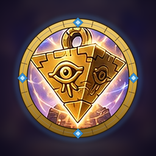
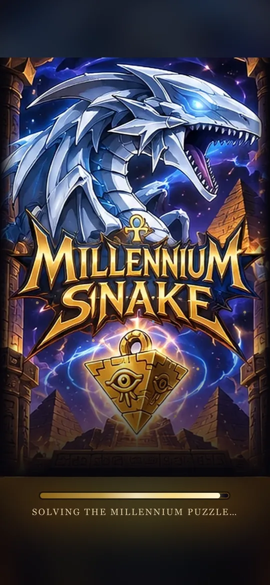
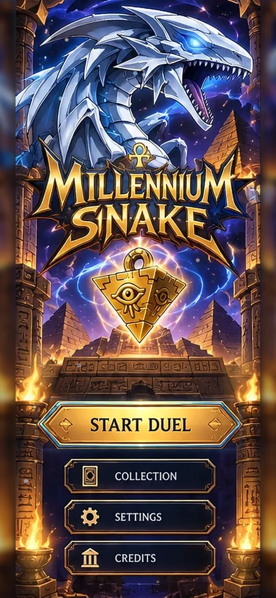
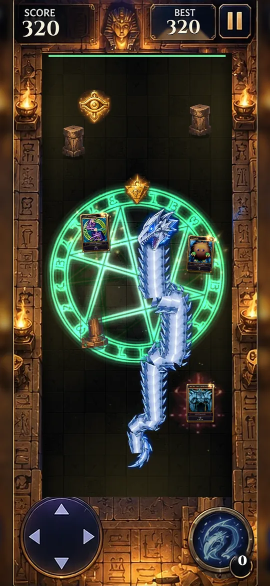
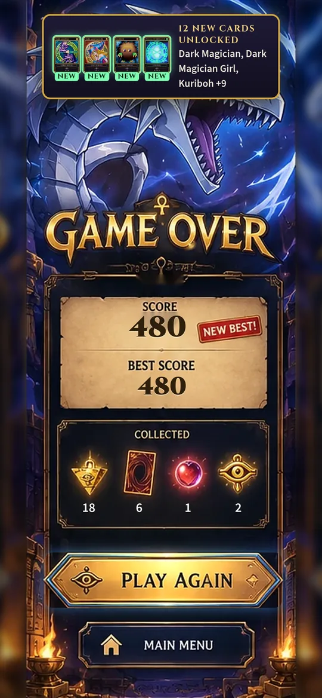
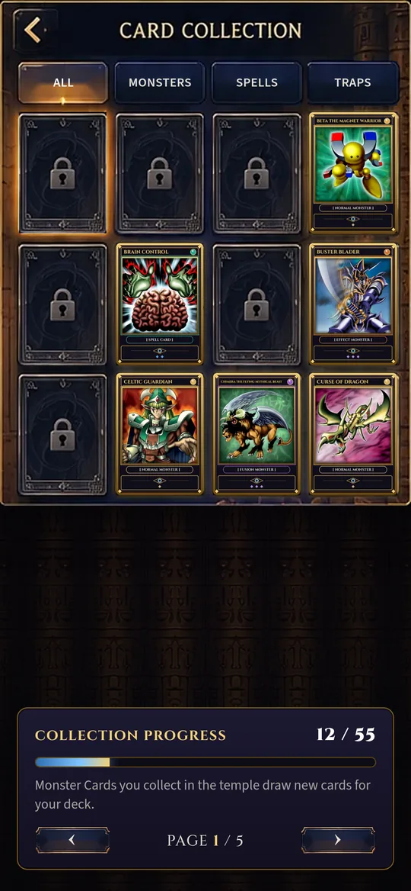
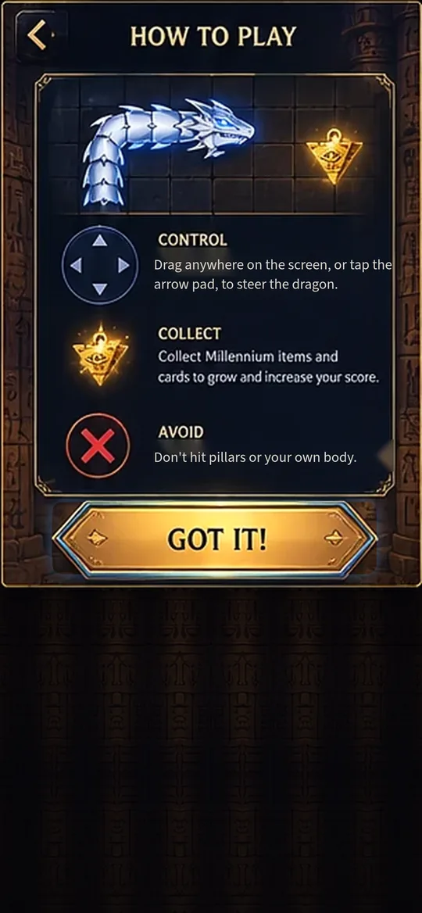
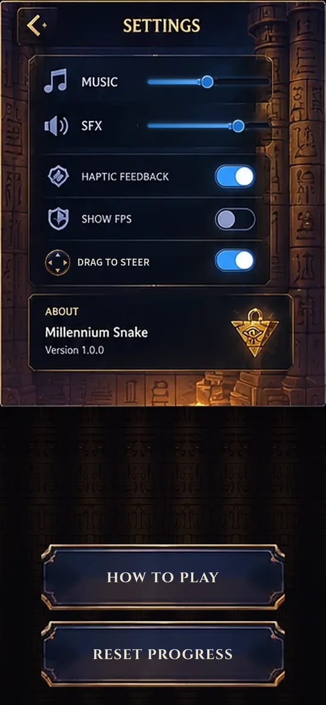
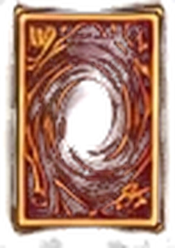

<div align="center">



# Millennium Snake

**Classic Snake, reborn in an Egyptian temple, with a Blue-Eyes-style dragon, the Millennium items and a deck of Duel Monsters cards.**

<a href="https://millennium-snake.vercel.app"></a>
<a href="https://github.com/0omarahmed73/Millennium_Snake/releases/latest/download/MillenniumSnake-universal-release.apk"></a>

<a href="https://github.com/0omarahmed73/Millennium_Snake/releases/latest"></a>


</div>

---

## Screenshots

<table>
  <tr>
    <td align="center"><br /><sub><b>Splash</b>: lightning reveal</sub></td>
    <td align="center"><br /><sub><b>Main menu</b></sub></td>
    <td align="center"><br /><sub><b>Duel</b>: Seal of Orichalcos active</sub></td>
    <td align="center"><br /><sub><b>Game over</b>: new best + cards</sub></td>
  </tr>
  <tr>
    <td align="center"><br /><sub><b>Card collection</b></sub></td>
    <td align="center"><br /><sub><b>How to play</b></sub></td>
    <td align="center"><br /><sub><b>Settings</b></sub></td>
    <td></td>
  </tr>
</table>

## Play

| | Where | Notes |
|---|---|---|
|  | **[millennium-snake.vercel.app](https://millennium-snake.vercel.app)** | Plays in any modern browser. On a phone, use *Install app* / *Add to Home Screen* for a full-screen, offline-capable PWA. |
|  | **[Download the APK](https://github.com/0omarahmed73/Millennium_Snake/releases/latest/download/MillenniumSnake-universal-release.apk)** | Signed release for Android 7.0+. Allow *Install unknown apps* for your browser or file manager, then open the file. |

<details>
<summary><b>Which Android file should I pick?</b></summary>

All builds are on the [Releases page](https://github.com/0omarahmed73/Millennium_Snake/releases/latest).

| File | Use it for |
|---|---|
| [`MillenniumSnake-universal-release.apk`](https://github.com/0omarahmed73/Millennium_Snake/releases/latest/download/MillenniumSnake-universal-release.apk) | Any Android phone (recommended) |
| [`MillenniumSnake-arm64-v8a-release.apk`](https://github.com/0omarahmed73/Millennium_Snake/releases/latest/download/MillenniumSnake-arm64-v8a-release.apk) | Most phones from the last ~8 years (64-bit ARM) |
| [`MillenniumSnake-armeabi-v7a-release.apk`](https://github.com/0omarahmed73/Millennium_Snake/releases/latest/download/MillenniumSnake-armeabi-v7a-release.apk) | Older 32-bit ARM phones |
| [`MillenniumSnake-x86_64-release.apk`](https://github.com/0omarahmed73/Millennium_Snake/releases/latest/download/MillenniumSnake-x86_64-release.apk) | Emulators / x86 devices |
| [`MillenniumSnake-release.aab`](https://github.com/0omarahmed73/Millennium_Snake/releases/latest/download/MillenniumSnake-release.aab) | Google Play upload (Play builds per-device splits) |

The game has no native code, so every APK contains the same game; the per-ABI files exist for stores and tooling that expect them.
</details>

## Features

- **Smooth, fair Snake.** Fixed-timestep engine (independent of frame rate), buffered turns with no instant reversals, speed that rises with your score, and walls that wrap you to the opposite side.
- **A dragon, not a line.** The Blue-Eyes-style head has four directional sprites; the scaled body is drawn along a smooth curve and slides seamlessly through the walls.
- **The Millennium items.** Puzzles grow the dragon, the **Millennium Eye** stores *Spirit Form* charges (phase through pillars and your own body), and **God Cards** are rare jackpots.
- **The Seal of Orichalcos.** Collect it and the sigil burns into the temple floor: green light, rising sparks and **double points** until it fades.
- **A 55-card deck.** Cards from the original duelists' decks, re-framed in the game's gold card style. Owned and locked cards appear on the board throughout every run; collect a locked one to add it to your deck.
- **Collection** with All / Monsters / Spells / Traps tabs, paging, rarity and unlock hints.
- **Feel.** Particles, score pop-ups, screen shake, haptics, the soundtrack plus synthesised sound effects, and an animated lightning-reveal splash with real loading progress.
- **Pixel-faithful UI.** Every screen is built on the original concept art, with live values drawn exactly where the art expects them.
- **Mobile first.** Portrait layout with safe-area support, no accidental scrolling, offline play as a PWA, and a native Android app via Capacitor.

## Controls

| Action | Phone | Keyboard |
|---|---|---|
| Steer | Drag anywhere (keep dragging to keep turning) or tap the D-pad | Arrow keys or `W` `A` `S` `D` |
| Spirit Form | Tap the dragon ring (bottom right) | `E` or `Enter` |
| Pause | Pause button | `Space`, `P` or `Esc` |

Drag-to-steer can be switched off in **Settings** if you prefer the D-pad only.

## Collectibles

| | Item | Points | Effect |
|---|---|---:|---|
|  | Millennium Puzzle | 10 | Grows the dragon; always on the board |
|  | Monster Card | 25 | Shows a deck card; collecting a locked one unlocks it |
|  | Egyptian God Card | 100 | Obelisk, Slifer or Ra |
|  | Millennium Eye | – | +1 Spirit Form charge (max 3) |
|  | Seal of Orichalcos | 50 | Field effect: double points for a while |

## Tech stack

| Layer | Choice |
|---|---|
| UI | React 19 + TypeScript (strict), plain CSS |
| Game | HTML5 Canvas, custom engine (`src/game/engine`), `requestAnimationFrame` fixed timestep |
| Build | Vite |
| Persistence | IndexedDB with a localStorage mirror |
| Audio / haptics | Web Audio API, Capacitor Haptics on Android, `navigator.vibrate` on the web |
| Mobile | Capacitor (Android), PWA manifest + service worker |
| Tests | Vitest |
| Hosting | Vercel |

## Project structure

```
src/
  game/
    engine/        SnakeEngine (pure rules, no DOM), GameLoop, config, types
    rendering/     Renderer (Canvas), art loader
    effects/       Particle system and score pop-ups
    GameSession.ts Glues engine + loop + renderer + input + audio
    input.ts       Keyboard and drag/swipe controls
  screens/         MainMenu, Game, GameOver, Collection, Settings, Info (How to Play, Credits)
  components/      ArtStage (concept-art screens), GoldButton, MagicBackdrop
  services/        storage, audio, haptics, cards (+ generated deck), app context
  ui/panels.ts     Pixel coordinates of every interactive spot on the concept art
public/
  art/             Panels and sprites cut from the concept sheet
  cards/           The 55 re-framed deck cards
  audio/           Soundtrack
  sw.js, manifest.webmanifest, icons/
scripts/           Art, card and icon pipelines (Python)
android/           Capacitor Android project
tests/             Engine and card tests
```

## Getting started

```bash
npm install
npm run dev        # http://localhost:5173 (also reachable from your phone on the same Wi-Fi)
npm test           # engine + card tests
npm run build      # type-check + production build into dist/
```

Requires Node.js 20.19+ or 22.12+.

## Building for Android

Requires JDK 21 and the Android SDK (platform 36). Point Gradle at the SDK once:

```bash
echo "sdk.dir=$HOME/Android/Sdk" > android/local.properties
```

**Debug build** (installable straight away):

```bash
npm run build && npx cap sync android
cd android && ./gradlew assembleDebug
# -> android/app/build/outputs/apk/debug/app-debug.apk
```

**Signed release** (AAB + per-ABI and universal APKs). Create `android/keystore.properties`, which is git-ignored:

```properties
storeFile=keystore/millennium-snake-release.jks
storePassword=…
keyAlias=millennium-snake
keyPassword=…
```

```bash
npm run build && npx cap sync android
cd android && ./gradlew assembleRelease bundleRelease
# -> app/build/outputs/apk/release/*.apk and app/build/outputs/bundle/release/app-release.aab
```

Bump `versionCode` / `versionName` in `android/app/build.gradle` for every release. Keep the keystore safe: updates must be signed with the same key.

`npm run cap:android` opens the project in Android Studio; `npm run cap:run` builds and runs on a connected device.

## Asset pipeline

The art comes from the concept sheet in `design/` and the card scans in `yugi_deck/`. Each script regenerates its outputs:

| Script | Produces |
|---|---|
| `python3 scripts/extract_art.py` | Screen panels and sprites in `public/art/` (dynamic text inpainted away) |
| `python3 scripts/build_cards.py` | `public/cards/*.webp` and `src/services/deck.generated.ts` |
| `npm run icons` | PWA, favicon and Android launcher icons |

Needs Python 3 with Pillow, NumPy, OpenCV and fontTools. To re-skin, replace files in `public/art/` with the same names.

## Deployment

The web build deploys to Vercel as a static Vite site (`vercel.json`). Pushing to `main` and running `vercel deploy --prod` publishes to [millennium-snake.vercel.app](https://millennium-snake.vercel.app).

## Credits

Made by **Omar A. Saeed**, Full Stack Web Developer.

<a href="https://github.com/0omarahmed73"></a>
<a href="https://linkedin.com/in/0omarahmed73"></a>
<a href="https://www.omarasaeed.dev/"></a>

Typefaces: [Cinzel](https://fonts.google.com/specimen/Cinzel) and [Source Sans 3](https://fonts.google.com/specimen/Source+Sans+3) (SIL Open Font License).

> **Disclaimer.** Millennium Snake is a non-commercial fan project made as a gift. Yu-Gi-Oh!, Duel Monsters, the card names and card artwork are the property of their respective owners (Kazuki Takahashi / Konami). This project is not affiliated with or endorsed by them.
